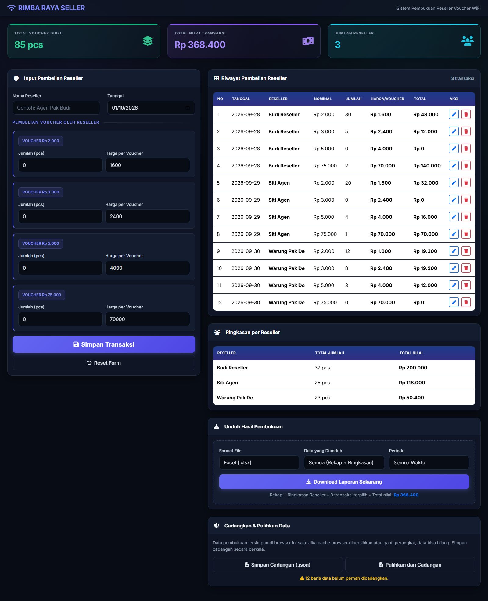

# RIMBA RAYA SELLER

Pembukuan penjualan voucher WiFi ke reseller. Berjalan sepenuhnya di komputer
sendiri — **tidak butuh internet, tidak butuh server, tidak ada biaya bulanan**.



---

## Cara memakai

Klik dua kali file:

```
web\index.html
```

Selesai. Tidak ada yang perlu dipasang.

### Mencatat pembelian
1. Isi **Nama Reseller** dan **Tanggal**
2. Isi **Jumlah (pcs)** dan **Harga per Voucher** untuk tiap nominal
   — nominal yang tidak dibeli cukup biarkan 0
3. Klik **Simpan Transaksi**

### Memperbaiki yang salah input
Klik ikon **pensil biru** di baris tabel. Datanya masuk kembali ke form,
perbaiki, lalu klik **Perbarui Transaksi**. Nama dan tanggal juga boleh diganti —
catatan lamanya otomatis dibereskan.

### Mengunduh laporan
Di kartu **Unduh Hasil Pembukuan**, pilih format (Excel/PDF), isi laporan, dan
periode, lalu klik tombol unduh. Laporan Excel berisi 3 lembar: rekap harian,
ringkasan per reseller, dan grafik penjualan.

---

## ⚠️ Cadangkan data secara berkala

**Data pembukuan tersimpan di dalam browser, bukan di dalam file.**

Artinya data akan hilang jika: cache/riwayat browser dibersihkan, pakai browser
lain, atau pindah komputer.

Karena itu biasakan:

1. Buka kartu **Cadangkan & Pulihkan Data** di bagian bawah halaman
2. Klik **Simpan Cadangan (.json)**
3. Simpan filenya di tempat aman — Google Drive, flashdisk, atau folder khusus

Untuk memulihkan: klik **Pulihkan dari Cadangan**, pilih file `.json` tadi.

| Pilihan | Artinya |
|---|---|
| **OK** | Ganti seluruh data sekarang dengan isi cadangan |
| **Batal** | Gabungkan cadangan dengan data yang sudah ada |

Aplikasi memberi peringatan kuning kalau data belum pernah dicadangkan, atau
cadangan terakhir sudah lewat 7 hari.

---

## Untuk yang mengubah kode

Buka `Rimba_Raya_Seller.code-workspace` di VS Code.

Seluruh aplikasi ada di satu file: `web/index.html`. Tidak ada build step —
edit, simpan, muat ulang browser.

Setelah mengubah apa pun, jalankan pemeriksaan:

```bash
cd tests
npm install     # cukup sekali
npm test        # harus: 38 LULUS, 0 GAGAL
```

Atau di VS Code: `Ctrl+Shift+P` → **Run Task** → *Jalankan Pemeriksaan*.

Pemeriksaan ini menjalankan aplikasi di Chrome sungguhan, lalu membuka kembali
file Excel dan PDF hasil unduhan untuk memastikan isinya benar.

Catatan teknis lebih lengkap ada di [CLAUDE.md](CLAUDE.md).

---

## Isi folder

| Folder | Isi |
|---|---|
| `web/` | Aplikasi. `index.html` + semua library di `assets/` |
| `tests/` | Pemeriksaan otomatis |
| `docs/` | Tangkapan layar |
| `template-excel/` | Script Python pembuat template Excel untuk pencatatan manual (terpisah dari aplikasi web) |
